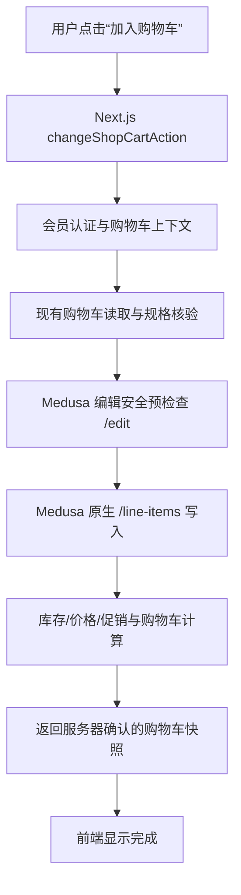
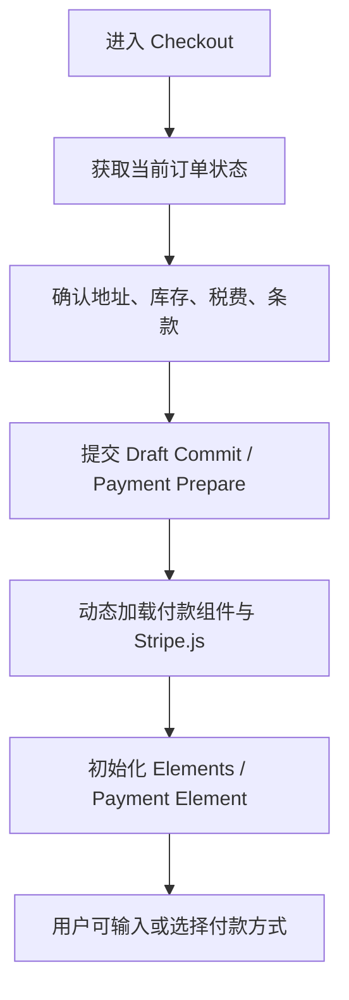
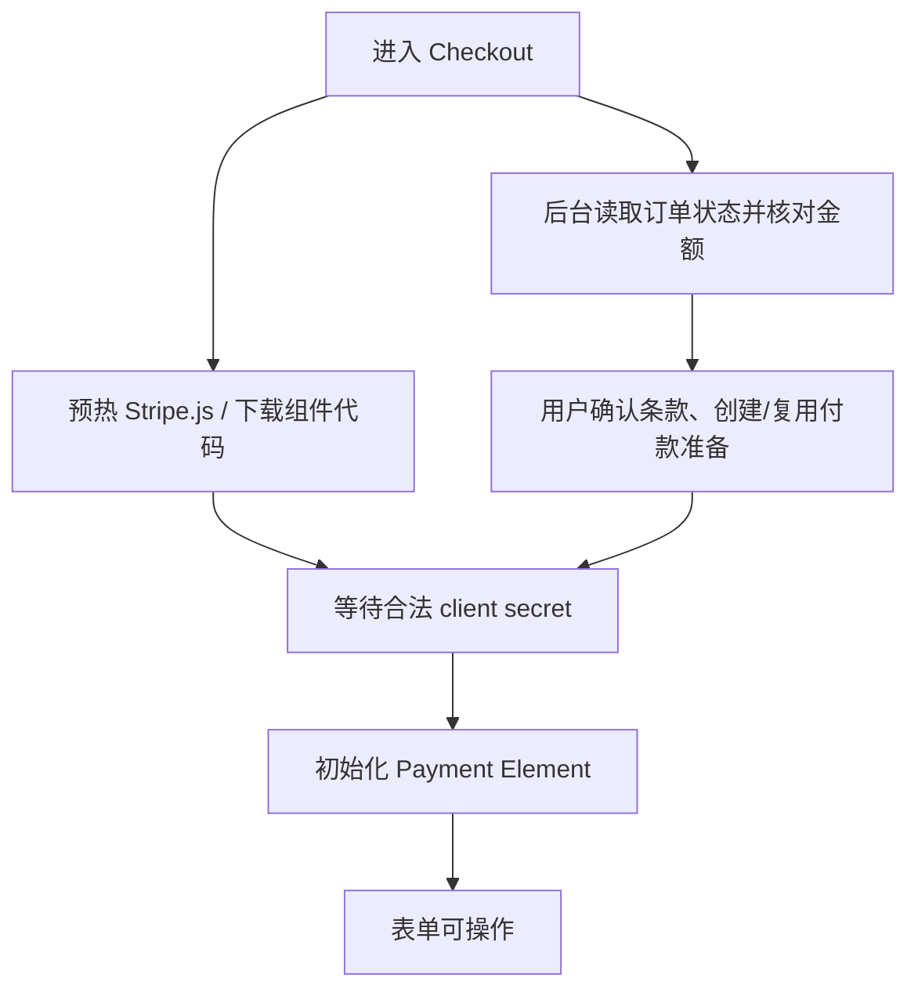

# Snow Force 商城：加购与付款界面性能优化计划 v3

> **文档状态：待实施优化方案**  
> **整理日期：2026-10-18（美国太平洋时间）**  
> **适用系统：** Snow Force 商城（Next.js 前端、Medusa Commerce 后端、PostgreSQL / Supabase、Redis、Stripe）  
> **核心原则：** 缩短真实请求耗时，而不只是延长超时或增加 Loading 动画；所有资金和订单安全检查必须保留。

## 1. 执行摘要

目前用户反馈两项体验仍然较慢：

1. 点击“添加购物车”后，商品真正写入购物车需要等待较长时间。
2. 从结账流程进入可操作的 Stripe 付款表单，仍要经历多阶段等待。

已经完成的前端即时反馈能够降低用户对卡顿的感知，但**不会直接加快 Medusa 写入或 Stripe 支付准备**。建议先建立端到端计时，随后分别优化加购写入链路与 Stripe SDK 初始化，再收敛 Checkout 最终确认中的重复读取。

**推荐实施顺序：PR-A 分段埋点 → PR-B Stripe 预热 → PR-C Medusa 加购工作流 → PR-D Checkout 最终确认。**

## 2. 已知现状与数据边界

### 2.1 线上部署状态（最近一次核查）

| 组件 | 当前已知状态 | 区域与版本 |
|---|---|---|
| 网站前端 | PR #34 已部署成功，包含加购即时反馈和不确定支付尝试恢复相关改动 | Railway `snowforce-web`，`sfo`，提交 `aa4ad8fa...` |
| 商城后端 | PR #33 已部署成功，包含 Checkout Draft 预估与最终确认架构 | Railway `snowforce-commerce`，`us-east4-eqdc4a`，提交 `c799ecb5...` |
| Stripe | 仍是站内支付组件与既有 Manual Capture 流程 | 本方案不改变收款模式 |

2026-10-18 最近一次查询中，Commerce 最近约 3 小时平均 CPU 使用量约 **0.0033 vCPU**，平均内存约 **0.48 GB**；近期没有足够相关慢请求样本来判断现版 p95。上述资源数据**不能证明所有性能问题都与实例容量无关**，但目前也不足以支持优先升级 Railway 套餐。

### 2.2 已记录耗时 vs. 目标

> **重要：** 当前数据多是以前从正式环境捕获的**单次请求样本**，而非可靠的 p95 基线；“目标”仅是拟定的验收标准，不能表述为已经达到。

| 操作 | 已知观测值 | 样本性质 | 下一版 p95 目标 |
|---|---:|---|---:|
| 点击加购至前端操作返回 | **约 7.50 秒** | 正式环境单次请求 | **≤ 3 秒** |
| Medusa `/line-items` 写入 | **约 4.23 秒** | 正式环境单次请求 | 测量后压缩关键路径 |
| 购物车编辑预检查 `/edit` | **约 0.98 秒** | 正式环境单次请求 | 合并冗余往返 |
| Checkout 首次读取 Server Action | **约 4.04 秒** | 正式环境单次请求 | **≤ 2 秒** |
| 结账地址/税费 Draft Preview Server Action | **约 3.88 秒** | 新版正式环境单次样本 | **≤ 2 秒** |
| 上项对应 Commerce 后端 Preview | **约 2.64 秒** | 新版正式环境单次样本 | 结合客户端链路优化 |
| 旧版 Quote 后端调用 | **约 7.58 秒** | 旧流程正式环境单次请求 | 不与 Draft Preview 直接等价比较 |
| 旧版报价对应 Checkout 请求 | **约 13.98 秒** | 旧流程正式环境单次请求 | 用新版分段测量替代 |
| 点击“继续付款”至 Stripe 表单可操作 | **暂无完整生产实测** | 必须增加浏览器埋点 | **≤ 3 秒**（热加载场景） |
| 确认支付至订单状态可核验 | **暂无完整生产实测** | Stripe/3DS/钱包可能有外部等待 | 尽量 ≤ 3 秒（排除外部挑战） |

> **计时口径必须一致：** 区分点击到视觉反馈、服务器返回、表单首次渲染、Payment Element `onReady`、用户可交互、Stripe 授权完成、订单完成；不可混用旧版与新版、热启动与冷启动、客户端与服务端样本。

## 3. 加购链路的根因分析与优化

### 3.1 当前调用链

**已证实的瓶颈：** 某次加购总时长约 7.50 秒，其中 `/line-items` 写入约 4.23 秒，编辑安全检查约 0.98 秒。即使前端抽屉立即打开，后端写入依然需要完成。

**需要实测才能判断的候选因素：**

- Medusa 原生 Workflow 中的重复定价、促销、商品和库存读取。
- PostgreSQL SQL 数量、慢查询、锁等待与事务持续时间。
- Redis 锁获取与释放、重试及跨区域往返。
- Medusa 返回购物车快照时不必要的关联数据加载。
- Next.js、Medusa、PostgreSQL、Redis 的实际区域分布及链路往返。

不得在缺少 Trace 的情况下断言 Redis 一定是主因。

### 3.2 P0-A：深入排查 `/line-items` 写入（优先）

为每次加购打一个可贯穿前后端的请求关联 ID，记录：

| 阶段 | 指标名建议 | 判断内容 |
|---|---|---|
| 浏览器点击到请求开始 | `cart.add.click_to_send_ms` | 客户端是否存在等待或队列阻塞 |
| Next.js 认证与会话 | `cart.add.auth_ms` | Supabase 用户认证与 Medusa 客户关联时间 |
| 现有购物车/商品核验 | `cart.add.read_validate_ms` | 读取是否串行、重复 |
| 编辑保护 | `cart.add.edit_guard_ms` | 原生锁、付款保护、报价失效检查 |
| 行项目工作流 | `cart.add.line_items_ms` | 最核心的已知慢阶段 |
| 数据库/Redis | `cart.add.db_ms`、`cart.add.lock_ms` | 慢 SQL、锁竞争和远程往返 |
| 总体 | `cart.add.end_to_end_ms` | 浏览器端体验 p50/p95/p99 |

每个阶段按生产流量采样并分组统计。禁止在日志中保存完整 JWT、PaymentIntent client secret、地址或其他敏感支付资料。

### 3.3 P0-B：减少串行网络请求

**推荐方案：** 为已有购物车设计一个受保护的“加购”后端原子入口，例如 `POST /store/snowforce/cart/:id/add`（路径仅为设计建议），在同一次后端操作中进行：

1. 校验用户身份与购物车所有权。
2. 检查未完成付款、结账锁和报价状态。
3. 校验当前 SKU、库存、数量和价格。
4. 执行 Medusa 原生商品更新，不绕过必要 Workflow。
5. 返回准确购物车快照，并保留失败/超时恢复证据。

**安全约束：** 不能把这些校验简单删除；合并网络往返不等于削弱校验。写入增加操作级幂等标识并处理重复点击、重复请求和超时后状态未知等情况。

**建议修改位置：**

- `src/lib/shop/cart-actions.ts`
- `src/lib/shop/commerce-cart.ts`
- `services/commerce/src/api/` 下的新端点或现有购物车 API
- 对应 Medusa Workflow、锁和查询实现

前端保留“立即打开购物车并显示进行中”，但不提前把未经后端确认的商品记为成功。

## 4. 支付表单加载：优先做 Stripe SDK 预热

### 4.1 当前潜在串行路径

当前组件结构中，`checkout-view.tsx` 在流程进入支付阶段后才动态引入 `stripe-checkout-form.tsx`。后者调用 `loadStripe()`，创建 Stripe `<Elements>`，并等待 `<PaymentElement onReady>`。

支付准备与 SDK 加载可能被串行化；**实际各段耗时需要浏览器性能事件验证**，不能直接把整个等待都归咎于 Stripe。

### 4.2 P0-C：安全地预热 Stripe.js

进入 Checkout 后，在适当时机开始异步预热 Stripe.js 及支付组件静态代码，争取让独立准备工作与后端读取并行：

具体要求：

- Stripe.js 必须按 Stripe 官方方式加载（不自行托管 SDK）。
- SDK/静态模块预热**不等于**预先创建 PaymentIntent、确认授权或扣款。
- 只有后端返回属于当前合法购物车及金额的 `clientSecret` 后，才创建对应的 Elements 实例。
- 避免在 UI 状态变化、无关重渲染或语言切换时重复初始化，必要更换支付实例时仍需正确销毁旧实例。
- 对慢网络、SDK 加载失败、3D Secure、钱包与移动浏览器做异常测试。

**建议修改位置：**

- `src/components/shop/checkout-view.tsx`
- `src/components/shop/stripe-checkout-form.tsx`
- 可共享的客户端 Stripe Loader（新文件，按需）

### 4.3 P0-D：压缩最终确认（Draft Commit → Payment Prepare）

当前 Checkout Draft 的预估与最终写入已经拆分。继续优化时应重点检查：

- `commitDraft()` 是否重复读取相同订单状态、配送方式或政策信息。
- `review()` 是否在同一个操作内再次取得已经校验且仍有效的证据。
- Payment Prepare 是否又做多次可合并的服务器往返。
- 付款表单 SDK 预热是否与上述步骤充分重叠。

**不得跨请求复用可能过期的购物车、库存、税额、支付状态或用户授权。** 优先传递当前操作中经过验证的版本和快照，并保留最终原生一致性检查。

**建议修改位置：**

- `src/lib/shop/checkout-actions.ts`
- `src/lib/shop/checkout-repository.ts`
- `services/commerce/src/api/store/snowforce/checkout/[id]/draft-commit/route.ts`
- `services/commerce/src/lib/checkout-draft-preview.ts`
- Stripe Payment Prepare / Recovery 相关服务

## 5. 用户体验优化，不伪造交易结果

| 场景 | 推荐交互 | 不允许的行为 |
|---|---|---|
| 点击加购 | 立即打开抽屉，显示“正在加入”；确认后更新商品与总额 | 未收到后端确认就显示加入成功 |
| 输入收货地址 | 保留可编辑输入，非阻塞计算运费/税费预估 | 用户每次输入都触发完整支付写入 |
| 点击继续付款 | 展示核验阶段，并尽快完成 Stripe 表单准备 | 先显示支付成功再等待结果 |
| Stripe 表单准备慢 | 稳定占位内容、明确网络失败与恢复入口 | 一直无提示地无限旋转 |
| 支付正在处理 | 显示“正在核验支付状态”，允许只读查询订单 | 未查明旧支付状态即创建第二笔支付 |
| 支付响应丢失 | 用原始支付标识安全恢复并确认状态 | 将网络超时自动判作支付失败 |

应明确区分 **支付已授权 / 订单已创建 / 实际资金已捕获 / 已发货** 四个不同状态。Manual Capture 流程下，订单确认不代表资金已经扣取或发货。

## 6. 分批实施方案

| 批次 | 优先级 | 交付内容 | 验收前提 | 建议上线方式 |
|---|---|---|---|---|
| **PR-A：端到端分段计时** | P0 | Next.js / Medusa / 浏览器 Stripe `onReady` 关联埋点；分场景 p50/p95/p99 | 指标口径统一，敏感信息脱敏 | 先发布，仅观测 |
| **PR-B：Stripe SDK 预热** | P0 | 下载与支付准备并行；避免无效重挂载；可恢复加载失败 | 桌面/移动/3DS/钱包测试通过 | 受控开关灰度 |
| **PR-C：Medusa 加购工作流** | P0 | 减少串行请求，优化锁、SQL 与原生工作流，确保幂等 | 所有权、库存、价格、并发、重复请求均通过 | 小流量灰度 |
| **PR-D：最终确认与 Payment Prepare** | P1 | 减少重复状态读取，压缩 Draft Commit 与 Prepare 链路 | Stripe Sandbox 完整支付矩阵通过 | 单独灰度 |

> 不建议把四个 PR 混成一个大版本；每一批必须能独立衡量收益、停止发布并回退。

## 7. 验收与测试矩阵

### 7.1 性能验收

- 每个核心场景都同时记录 `p50 / p95 / p99 / 错误率 / 超时率`。
- 分开比较首次访问（冷加载）、重复访问（热加载）、桌面宽带、移动慢速网络。
- 至少分别统计：新购物车首次加购、已有购物车再加购、带优惠券购物车、已有未完成付款的购物车。
- 付款表单“可操作”以 `PaymentElement onReady` **及必要 SDK/Elements 可用状态**为准，不以组件出现骨架屏为准。
- 各批次使用一致输入和环境，避免低流量样本造成虚假“提升”。
- 灰度与旧版对照，若错误率或不确定支付状态显著恶化则立即停止放量。

### 7.2 功能和安全验收

**加购：** 库存不足、价格变化、数量上限、跨用户购物车、购物车已结账、付款锁定、超时重试、多标签页并发、双击加购。

**结账：** 地址更改、配送/自提切换、税率变化、Quote 过期、条款版本变化、优惠更新、原生金额最终复核。

**Stripe：** Stripe Sandbox PaymentIntent 准备、支付表单初始化、3D Secure、异步支付、失败重试、丢失响应、回调重复、Webhook 幂等、Manual Capture 状态、取消与恢复。

生产环境不得为测速触发真实授权、扣款、退款或取消资金操作。涉及资金动作的全链路测试须在 Stripe Sandbox 或隔离测试环境执行。

## 8. 发布与回滚策略

1. **先观测：** 部署 PR-A，收集有效基线；定位主因前不调整机器规格或大规模重构。
2. **再预热：** PR-B 使用可关闭的前端开关；若 Stripe 初始化失败率提高，立即关闭预热并退回原加载路径。
3. **再优化写入：** PR-C 用新旧加购端点隔离，保持原生安全路径；灰度比较 p95、重复加购与库存一致性。
4. **最后压缩付款准备：** PR-D 不改变金额和资金状态的不可逆处理规则；异常时切回旧的 Checkout 分支。
5. **保留证据：** 回滚仅切换行为/部署版本；不得清除 Draft、Quote、Payment、Order 和相关幂等记录。

### 立即停止发布的条件

- 出现跨用户购物车访问、金额错误、库存超卖或重复支付风险。
- 支付/订单状态无法恢复、确认后出现明显重复订单。
- p95 没有改善而错误率、超时率或不确定交易比例明显上升。

## 9. 不优先采取的措施

- **直接升级 Railway 规格：** 当前没有充分 CPU/内存证据支持这是根因。
- **仅延长请求 Timeout：** 增加允许等待时间，不等于减少真实执行时长。
- **直接迁移数据库或 Redis：** 应先采集数据库及锁等待证据，并确认实际跨区部署拓扑。
- **换成 Stripe 托管 Checkout：** 这会改变现有体验和支付架构，尚无证据表明是解决当前性能问题的必要条件。
- **简单绕过税费、库存或支付保护：** 不能以资金/履约安全换取响应速度。

## 10. 执行清单

- [ ] 为浏览器、Next.js Server Action、Medusa 和 Stripe SDK 建立统一计时与关联 ID。
- [ ] 收集当前正式环境加购及支付表单可操作时间的足量基线。
- [ ] 为 `/line-items` 获取 SQL / Redis / 工作流分段 Trace，并排序最慢子阶段。
- [ ] 在 Checkout 页面安全预热 Stripe SDK/组件静态代码。
- [ ] 测试并消除 Stripe Elements 的不必要重复初始化。
- [ ] 设计并验证受保护、幂等的加购单入口，减少前后端串行往返。
- [ ] 检查 Draft Commit → Review → Payment Prepare 的重复读取。
- [ ] 完成单测、集成测试、浏览器测试、Stripe Sandbox 测试。
- [ ] 按 PR 独立灰度发布，比较关键 p95 与异常率，记录最终收益。

---

### 最终决策

**先做 PR-A 与 PR-B，尽快压缩付款界面的 SDK 串行等待；随后基于真实 Trace 优化 `/line-items` 写入；最后再动支付最终核验。** 目前最明确的耗时证据是 Medusa 行项目写入约 **4.23 秒（单次样本）**，但还不足以断言具体是 SQL、Redis 还是某一子工作流占主导。

**本文是实施计划，不代表上述 v3 优化已经写入代码、合并或部署。**
