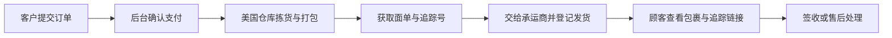

# SnowForce 完整商城与美国自发货方案

调研日期：2026-09-29 至 2026-09-30。业务条件：美国现货、自行发货；前台只显示美元，保留已认可的 SnowForce 设计。

建议采用 **现有 SnowForce 前台与 Supabase Auth + Medusa 商城后台 + 同一 Supabase 数据库内的商城分类**。运营人员在后台上架商品、维护规格库存、处理订单和退换货；顾客使用原来的 SnowForce 账号，在现有网站完成购物车、结账、订单查询和物流查看。第一版采用固定运费与手动录入追踪号，后续按订单量接入自动面单服务。

2026-09-30 实施更新：已在 `services/commerce` 安装并固定 Medusa 2.21.2，现有 Supabase 的私有 `commerce` schema 已有 147 张核心与关联表，14 款商品全部导入为草稿，商品图片存入现有 Storage。尚未开放真实结账、部署后台或创建交易订单。当前状态与运行步骤见 [商城后台实施记录](shop-commerce-implementation.md)。

## 已找到的完整项目

| 项目 | 完整性与已核实依据 | 对 SnowForce 的判断 |
| --- | --- | --- |
| [Medusa DTC Starter](https://github.com/medusajs/dtc-starter) | 同一仓库包含 `apps/backend` 和 `apps/storefront`；前台有商品、购物车、多步结账、客户账户、订单历史和地址管理。后台有商品、库存、订单和促销。实际进入官方后台，并浏览美国地区前台。 | **首选**。现有 Next.js 界面可通过 Store API 接入，商品与交易由独立后台负责。 |
| [Spree Storefront](https://github.com/spree/storefront/tree/main) 与 [Spree Backend](https://github.com/spree/spree) | 前台说明包含商品筛选、规格、购物车、结账和账户；`create-spree-app` 可一起创建后端与前台。前台需要运行中的 Spree 后端。 | 备选。交易功能完整，但要增加独立的 Spree 后端运维。 |
| [CRMEB](https://github.com/crmeb/CRMEB) | ThinkPHP、ElementUI、UniApp，包含 PC、H5 和小程序等渠道；[标准版发货文档](https://doc.crmeb.com/single/v54/13789)覆盖录入单号、电子面单和拆单发货。 | 继续参考中文运营流程。文档中的面单采用一号通与快递月结账号，美国承运商、美元与支付适配需要另行核实。不能将其他商业版本功能直接当成这个开源仓库自带。 |
| [Saleor Storefront](https://github.com/saleor/storefront) 与 [Saleor Platform](https://github.com/saleor/saleor-platform) | 前台、GraphQL API、Dashboard 分开；Platform 提供本地开发组合，README 明确不用于生产部署。 | 能搭建完整商城，但对当前规模需要更多服务集成，不作为第一版选择。 |

上述适配判断是结合当前项目的工程建议，不是上游项目对 SnowForce 的承诺。开源代码之外，托管、支付、邮件、税费服务和物流仍需各自配置与运营。

可直接查看：[Medusa 美国前台](https://next.medusajs.com/us)、[Medusa 官方后台演示](https://demo.medusajs.com/app/login?demo-user=true)、[Spree 美元前台](https://demo.spreecommerce.org/us/en)、[CRMEB 前台](https://v6.crmeb.net/)与[后台](https://v6.crmeb.net/admin)。

## 当前网站与完整商城的差距

当前 `src/lib/shop/catalog.ts` 是 14 款商品的静态目录；`src/lib/shop/selection.ts` 是浏览器中的选款咨询清单。当前 `/admin` 管理活动、报名、商家摊位等业务，没有装备商品、商城订单、仓库或物流模块。

现有美元金额是图册价格换算后的参考价，不能直接作为真实成交价格。导入商城时应把商品先建成草稿，确认实际美元售价、真实可售规格和每个规格的美国库存后发布。品牌图册提供了颜色和尺码范围，也不代表每个组合都已备货。

## 单数据库数据方案（2026-09-30 更新）

**只使用网站现有 Supabase 项目和同一个 PostgreSQL 数据库，不新增数据库项目。客户继续使用现有 Supabase Auth 与账号。** 上一版建议新建第二个 Supabase 项目已被本方案替代。Supabase 本身提供 PostgreSQL；数据库中的 schema 相当于业务分类，并不是另一台数据库。[Supabase 数据库说明](https://supabase.com/docs/guides/database/overview)

核对确认：本地配置连接现有 Snow-Force web 项目，区域为美国 us-east-2；其数据库已有会员、活动、报名等表。会员订单读取表、收货地址表和 Medusa 核心表已应用到这一项目，Medusa 服务的正式部署与交易接入仍待完成。下面区分现有业务、已安装商城数据和后续接入。

| 分类 | 存储位置 | 数据与管理职责 |
| --- | --- | --- |
| 客户身份 | 现有 `auth` schema | Supabase Auth 负责账号、密码验证、Google 和邮件登录；不新增第二套客户密码 |
| 会员 | 现有 `public.member_*` 表 | 会员资料、隐私同意、雪票和装备资料，继续沿用现有网站 |
| 活动 | 现有 `public.events`、`registrations` 等表 | 活动、报名和活动支付保持现有结构，不为商城迁移或重命名 |
| 商城核心（表已安装，服务待正式部署） | **同一数据库的 `commerce` schema** | Medusa 管理商品、SKU、美元价格、仓库、库存、购物车、交易订单、履约与售后；作为这些业务的唯一来源 |
| 会员商城订单读取 | 新增 `public.shop_member_orders` | 面向会员中心的只读订单快照，包含归属用户 UUID、商品和金额快照、状态及包裹追踪；普通客户不能创建、改价或改变订单状态 |
| 网站收货地址簿 | 新增 `public.shop_shipping_addresses` | 绑定现有 Auth 用户 UUID，客户可以维护自己的美国地址；下单时复制到交易订单快照，修改地址簿不改历史订单 |
| 商品图片 | **现有项目的 Supabase Storage**，`shop-products` bucket | 已上传 14 张草稿照片；后台持续上传使用已配置的 S3 provider，待填服务端 S3 凭据；会员私人资料与公开商品图片不混用 |

`shop_member_orders` 是供网站读取的订单投影，**不是第二套库存、售价或交易引擎**。Medusa 安装后，可信服务端须在订单、履约和售后状态改变时同步此投影，并处理重试、金额单位和稳定用户 ID。此次会员中心接入订单读取和地址簿，尚未实现 Medusa 订单同步、真实商品定价、库存管理或收款。没有真实订单时不放入演示订单。

### Medusa 如何连接同一数据库

已核对 Medusa 上游配置类型，包含 `projectConfig.databaseSchema`，默认值为 `public`。当前配置已指定 `commerce`，连接现有项目的同一个 `postgres` 数据库，专用角色无法创建数据库或修改现有会员、活动表；安装未运行创建新数据库的命令。[Medusa 配置源码](https://github.com/medusajs/medusa/blob/develop/packages/core/types/src/common/config-module.ts)

配置形态如下，当前后台源码已采用这一配置，**服务尚未正式部署**：

```ts
export default defineConfig({
  projectConfig: {
    databaseUrl: process.env.DATABASE_URL, // 现有 Supabase 数据库的服务端连接
    databaseSchema: "commerce",
    // 其余认证、CORS、Redis、SSL 等按选定 Medusa 版本配置
  },
});
```

正式运行前需固定版本，并在隔离测试环境验证迁移、模块链接表、扩展模块及全套查询均进入 `commerce`。使用专用数据库角色，权限限定在商城 schema；不能默认把整套 Medusa 迁移写入现有 `public`。商城 schema 不向浏览器的 Supabase Data API 开放，网站通过商城服务读取核心数据。

常驻 Medusa 服务优先使用 Supabase 直接连接；IPv4 环境可评估 session pooler。SSL、连接数、迁移连接及驱动兼容需要实测，不把 transaction pooler 当作无条件兼容。[Supabase 连接说明](https://supabase.com/docs/guides/database/connecting-to-postgres)

此方案省去第二个数据库项目；商城使用现有项目的数据库、存储和流量配额。Medusa 的 Node.js 服务、worker 和 Redis 仍需运行环境，单数据库不等于后台服务免费。[Medusa 部署说明](https://docs.medusajs.com/learn/deployment)

### 归属、权限与数据更新

会员中心直接复用现有登录，在服务端从可信 Supabase 身份取得用户 UUID。订单和地址查询显式限定 `user_id`，数据库再用 `auth.uid() = user_id` 的 RLS 检查一遍。无登录身份不能读取私人资料；不能仅凭邮箱或浏览器给出的用户 ID 认领订单。[Supabase RLS](https://supabase.com/docs/guides/database/postgres/row-level-security)

订单投影只给普通会员读取本人记录的权限；写入由可信后台负责，不能让前台创建“已付款”状态或修改金额。金额以美元美分整数保存，并核对商品金额、运费、税费、优惠与总额。支付确认仍应来自验证过的支付回调，不从成功页参数推断。

收货地址新增、编辑、删除都验证当前登录身份、已确认邮箱和现有会员同意状态。数据库使用 `SECURITY INVOKER` 地址函数，不绕过 RLS；默认地址通过每个用户的事务锁和唯一索引维护。修改或删除地址簿中的地址，不修改既有订单的收货快照。

已编写并测试 Supabase 客户认证 provider 与服务端关联接口，将验证后的 Supabase 用户 UUID 关联到 Medusa customer 记录；真实浏览器登录与完整购物流程仍待联调。**共用数据库不会自动共用框架的登录会话。** 顾客继续在现有网站登录，服务端完成关联；不要求再次注册商城账号。[Medusa Auth 模块](https://docs.medusajs.com/resources/commerce-modules/auth)

### 图片与备份

Medusa 官方 S3 provider 支持 Supabase Storage，需要配置 endpoint、商品图片公开 URL 和 `forcePathStyle`，凭据只留在后台。[Medusa S3 provider](https://docs.medusajs.com/resources/architectural-modules/file/s3)

数据库统一备份；Storage 图片文件另行备份，因为数据库备份不包含图片内容。共用数据库的恢复操作会涉及所有业务，须记录商城迁移版本，并验证会员、活动与商城功能一起恢复。[Supabase 备份说明](https://supabase.com/docs/guides/database/overview)

## 新会员中心

客户登录方式继续沿用现有 Supabase；已登录后使用统一的个人中心，导航、订单内容和状态支持中文与英文。

| 页面 | 信息与行为 |
| --- | --- |
| `/member` 概览 | 最近商城订单、订单分类入口、下一趟活动、未完成的活动报名、资料完成度和收货地址入口 |
| `/member/orders` 我的订单 | 全部、待付款、待发货、运输中、已送达、取消与退款分类；每页 10 笔，保留历史快照 |
| `/member/orders/[id]` 订单详情 | 商品、数量、美元金额、配送进度、包裹追踪、下单收货地址与客服入口；他人订单返回未找到 |
| `/member/addresses` 收货地址 | 新增、编辑、删除美国地址；默认地址由服务器与数据库维护 |
| `/member/trips` 我的活动 | 保留原有活动报名与历史功能，使用统一个人中心导航 |
| 资料与账号页面 | 保留滑手资料、雪票装备和密码管理，使用相同导航，不迁移现有账号 |

概览与订单页面不显示虚构的购买记录，也不把当前浏览器“选款咨询清单”当作正式订单。数据库或配置出错时明确显示读取失败，不能冒充“没有订单”。

仅开发环境开放 `/design-preview/member`，用明确标识的示例数据展示有订单时的页面；预览不会写真实地址或订单。生产模式下该入口由现有设计预览守卫返回 404。

## 实施与验收边界

此次会员中心的订单读取、地址簿和同库权限基础，独立于尚未上线的 Medusa 后台。真实商品上架、运营库存、支付、订单投影同步和物流自动更新仍按后续技术接入顺序实施。普通会员页面不提供虚假的付款或“自动退货”按钮。

迁移只新增 `shop_member_orders`、`shop_shipping_addresses`、索引、本人 RLS 和两个地址操作函数，不更改旧活动表、登录账号或现有支付逻辑。应用前单独审阅这一份 SQL；已有其他本地迁移不随之应用。

需要验证：同一登录进入会员概览与订单；只能读本人订单和地址；过期或匿名身份无法访问；订单读取故障与空数据不同；地址表单校验、默认地址原子切换与删除后默认递补；订单筛选与分页；手机号、邮编、中英文和手机布局；活动待确认与支付入口仍可使用。

## 完整页面范围

以下为 SnowForce 的目标页面清单；已实施的会员订单页面单独标明，其余交易功能仍待后台接入。

| 顾客页面 | 目标行为 | 实施方式 |
| --- | --- | --- |
| 商城首页与商品列表 | 分类、品牌、搜索、排序，只展示已发布且属于商城渠道的商品 | 保留当前设计，接入后台目录 |
| 商品详情 | 图库、颜色尺码、实际美元价、可售数量、配送说明 | 接入真实 SKU 与库存状态 |
| 购物车 | 修改数量、删除、优惠码、金额重算、库存变化提示 | 用后台购物车替换咨询清单 |
| 结账 | 邮箱、美国地址、配送方式、支付、费用明细 | 参考 DTC Starter，适配 SnowForce 界面 |
| 订单确认 | 订单号、已确认支付状态、商品快照和预计处理时间 | 新增；支付状态来自后台 |
| 我的订单与订单详情 | 订单历史、分包裹状态、追踪号与承运商链接 | 已接入同库会员读取与本人访问校验；真实交易同步待接入 |
| 退换货申请 | 选择商品、数量、原因，查询处理进度 | 后台具备退货能力；顾客申请界面需另外接入 |
| 配送与退换说明 | 配送范围、处理时间、退货地址和规则 | 根据实际经营政策填写 |

Medusa 仓库提供购物与账户基础流程；自助售后、交易与物流事件同步以及 Medusa 客户认证适配仍需实施。此次已完成 SnowForce 会员中心的订单/地址界面与现有 Supabase 账号接入，不能把框架能力等同于全套交易功能已完成。

## 后台如何搭建

建议先使用 Medusa Admin 完成日常运营，再按实际需要添加 SnowForce 扩展。后台的商品、订单与库存页面已经存在，可以减少重复开发。[官方 Admin 介绍](https://medusajs.com/admin)说明了这些管理功能及扩展入口。

| 后台模块 | 日常操作 |
| --- | --- |
| 商品 | 新建草稿、编辑中英文资料、上传图片、分类品牌、批量导入、发布和下架 |
| 规格与价格 | 每个真实颜色和尺码组合设置唯一 SKU、美元售价、重量和包装尺寸 |
| 库存 | 美国仓库入库、盘点、可售数量、已预留数量、缺货管理 |
| 订单 | 查看支付与履约状态、订单明细、地址、部分发货、取消与退款 |
| 配送 | 配送区域、固定运费、包邮条件、包裹和追踪号 |
| 售后 | 退货原因、批准退货、收货检查、可再次出售与损坏数量、退款 |
| 客户与促销 | 客户记录、优惠码、促销活动和价格表 |

后台界面应以密集表格、明确状态与快捷操作为主，延续 SnowForce 后台的实际工作风格。前台的品牌视觉与后台的运营布局分别适配。

## 新品上架步骤

官方[商品创建指南](https://docs.medusajs.com/user-guide/products/create)提供资料、归类、规格三个主要步骤，并支持 SKU、库存管理、渠道和各币种价格。我们建议以下运营顺序：

1. 创建草稿，填写中英文名称、品牌、分类、描述、尺码说明和图片；保留当前商品 slug，避免原链接失效。
2. 只建立实际销售的颜色和尺码组合。每个组合有独立 SKU，例如 `VECTOR-DUSK-PINK-M`。
3. 填写实际美元售价。当前换算参考价只作为内部选款资料，不自动变成销售价格。
4. 打开库存管理，为 SKU 录入美国仓库实物数量；现货模式默认关闭缺货预售。
5. 补齐重量、包装尺寸和配送配置。检查商品属于 SnowForce 商城销售渠道。
6. 预览商品详情，核对图、规格、售价与库存，再发布。发布后验证列表、详情和购买入口均更新。

中英文内容的编辑和前台显示需落实翻译字段与适配规则；原生后台出现翻译菜单并不能证明当前自定义字段会自动按 SnowForce 语言切换。

## 美国现货自行发货



第一版设一个美国仓库。运费已确认：优惠后商品小计满 US$100 包邮，否则 US$9.95；税费和运费不计入包邮门槛。已实现后台运费编辑页与价格规则读写，待仓库和实际美国配送区域建立后初始化到配送选项。阿拉斯加、夏威夷、邮政信箱等地址是否接受与计费仍需确定。

运营人员收到已付款订单后拣货、称重、打包，在自己的承运商或寄件平台获取面单，再在后台创建履约记录并录入追踪号、追踪链接。多个包裹需要分别记录商品数量和追踪号。Medusa 的[订单履约指南](https://docs.medusajs.com/user-guide/orders/fulfillments)支持部分履约与 shipment tracking 信息。拣货完成和交给承运商应对应不同状态，避免面单一生成就把订单当作已交运。

**录入追踪号与自动物流追踪是两个能力。** 第一版可以让顾客打开承运商追踪链接；站内自动更新“运输中、已送达、异常”需要另外接入承运商或物流平台回调。

后续自动化可采用 [Medusa 官方 ShipStation 集成指南](https://docs.medusajs.com/resources/integrations/guides/shipstation)，实现取运费、创建履约和获取面单。它需要开发 fulfillment provider，并配置 ShipStation 账号、承运商与 Shipping API；不是在原始 starter 上打开一个开关就完成。运费模式也应根据 provider 能力选择固定或实时计算。

ShipStation 的[面单文档](https://docs.shipstation.com/create-labels)说明，生产 API 创建面单会实际购买邮资；开发和验收必须先使用测试环境，真实邮资费用由运营人员确认后执行。

## 退换货如何处理

建议流程为：顾客提出申请 → 核对商品与原因 → 给出退货指引 → 美国仓库收货检查 → 记录可再次销售和损坏数量 → 按政策退款或换货。不要在申请提交时直接把库存加回。

Medusa 的[退货指南](https://docs.medusajs.com/user-guide/orders/returns)覆盖申请、退货收货、损坏数量与退款处理。顾客申请页面、通知模板、退货期限、运费承担和退货地址需要结合 SnowForce 的实际政策实施。换尺码还需要验证替换 SKU 的库存。

## 技术接入顺序

| 阶段 | 交付 | 验收标准 |
| --- | --- | --- |
| 1 数据与登录样品 | 隔离测试商城后台与同库 schema、Supabase 客户身份关联、US 与 USD 配置、美国仓库、1 款商品 | 现有会员无需新账号；只能读取本人订单；后台修改价格、库存和发布状态能反映到测试前台 |
| 2 商品迁移 | 将现有 14 款逐一迁移为草稿并审核；保留 slug、图片来源和中英文资料 | 资料不明的规格不可购买；已发布商品显示实际美元价格 |
| 3 购物与结账 | 服务端购物车、美国地址、运费、测试支付、订单确认 | 金额由后台重算；缺货、失败支付、重复请求和取消流程正确 |
| 4 发货与售后 | 后台部分发货、追踪号、顾客订单详情、退货和退款 | 每个包裹商品数量正确；退货检查与库存、退款记录一致 |
| 5 运营上线 | 邮件、客服、配送与退货政策、税费配置、权限、备份与监控 | 用测试商品完整演练上架、购买、发货、追踪、退货，再切换正式配置 |

实现时保留当前 Next.js 网站；商城服务独立部署，数据库与现有网站共用并按 schema 分类。DTC Starter 当前前台配置使用 Next.js 15 和 React 19，而 SnowForce 使用 Next.js 14 与 React 18，因此通过 Store API 与适配层接入，逐个验证数据、缓存和结账行为，不直接覆盖整个现有应用。[上游依赖配置](https://github.com/medusajs/dtc-starter/blob/main/apps/storefront/package.json)

后台需要自己的服务与正式环境基础设施；生产 worker、队列与持久化按所选版本部署要求配置。默认采用前述独立 Medusa 服务与现有 Supabase 数据库、Storage，现有网站托管继续使用。选定配置后再核对实际费用，本方案不报价。

商城订单与活动报名、活动支付分开存储，客户登录统一使用现有 Supabase Auth。访客结账是可选的独立能力，不作为绕过统一账号接入的默认方案；如开放，需另行明确访客订单访问与后来认领的验证流程。

统一数据与账号方案上线前，至少验证：已有会员购物、新客户注册、Google 与邮件登录返回结账、购物车恢复与重复请求、改邮箱后原订单仍可见、同邮箱不能未经验证认领订单、客户不能访问他人订单和地址、退出与过期会话不可继续访问、并发登录不会重复创建客户，以及后台调价与库存变更后的购买行为。

## 实施前需要的经营资料

发货模式已确认。接入真实交易还需要：每个 SKU 的美元售价与美国库存、仓库发货和退货地址、包装重量尺寸、实际配送范围与运费、退换政策、正式支付和物流账号。先用隔离测试环境完成交易验证，再配置这些正式资料。

## 本次验证记录

查阅了四个项目的官方仓库、Medusa 上架和售后文档、CRMEB 标准版发货文档及 ShipStation 官方集成资料。实际进入 Medusa 公开后台，核实 Orders 的支付和履约列、Products 的导入与创建入口、草稿与发布状态，以及包含资料、归类、规格步骤的新建商品表单。

Medusa 前台从默认 Denmark 切换到 United States 后显示 `/us` 与美元价；商品详情包含图库、配送退换信息和购物车入口。实际将演示 Hoodie 加入购物车，看到数量编辑、优惠码、美元费用汇总，并进入包含 Shipping Address、Delivery、Payment、Review 四个阶段的结账表单。没有提交地址或付款。参考截图为 `output/playwright/medusa-us-checkout-reference.png`。

试验只针对官方演示商品，不涉及当前 SnowForce 选款清单。公开演示和仓库功能核实不等于 SnowForce 的真实支付、物流或权限已经通过验收。

2026-09-30 方案调研阶段核对了现有 Supabase 登录、身份读取和回调白名单，以及 Supabase PostgreSQL、连接、Storage 和 Medusa Auth、S3、部署文档。随后按单数据库要求实施会员中心与本人订单/地址权限；统一商城认证适配、商品库存后台、支付与物流同步仍是后续接入工作。

此前调研与数据方案补充只改文档。2026-09-30 按单数据库要求实施了会员中心；本节以前的测试结果只对应此前文档交付。此次代码、迁移与权限验证见 [会员中心实施记录](member-center-implementation.md)。

前次方案交付检查：`npm test` 通过，112 个文件、689 个测试；`npm run build` 通过；`git diff --check` 通过。首次受限测试运行因既有 Vitest 缓存写权限返回失败，取得缓存写入权限后重跑正常退出。测试和构建仍有既有 React 测试适配、Vite CJS 与图片优化提示，未把它们记录为本次新增问题。日志为 `output/shop-backend-test.log` 和 `output/shop-backend-build.log`。这些检查验证现有应用，不代表本方案尚未实施的统一商城登录已通过测试。

此次文档补充后再次运行：`npm test` 通过，112 个文件、689 个测试；`npm run build` 正常退出；文档无行尾空格，代码块成对。日志为 `output/shop-data-plan-test.log` 和 `output/shop-data-plan-build.log`。
