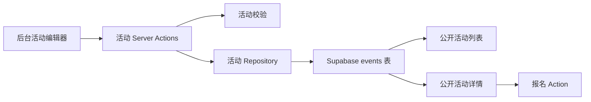

# Supabase 活动后台编辑器设计规格

## 摘要

SnowForce 的活动内容需要从前端种子数据中迁出，让工作人员可以在后台
创建、编辑、发布和运营活动。本次增量把 Supabase `events` 表作为活动运营
数据的正式来源，同时继续沿用当前基于后台密码的工作人员登录方式。

第一版编辑器只聚焦活动管理，不同时引入 Supabase Storage 图片上传、
Supabase Auth 工作人员登录迁移、富文本编辑、批量导入、版本历史，或回顾与
FAQ 的完整数据库编辑器。

## 目标

- 公开活动列表页和活动详情页从 Supabase 活动记录读取内容。
- 已登录后台的工作人员可以创建活动草稿。
- 已登录后台的工作人员可以编辑现有公开页面和报名表单所需的完整活动内容。
- 已登录后台的工作人员可以发布、取消发布活动，并开放或关闭报名。
- 保留当前中英双语活动模型和可配置报名字段。
- 给现有 `seed.ts` 活动提供清晰的迁移路径，迁入 Supabase 后日常更新不再改代码。

## 暂不包含

- 在活动编辑页上传图片到 Supabase Storage。
- 把 `/staff-login`、`ADMIN_PASSWORD` 和当前后台 cookie 会话迁移到
  Supabase Auth 与 `staff_roles`。
- 给回顾、FAQ、媒体资源和合作咨询做完整 CMS 后台。
- 富文本编辑器、活动预览流程、活动复制、版本历史和批量工具。

## 推荐方案

以 Supabase 作为活动主数据源。所有后台写操作都通过服务器端 action 完成：

1. 检查当前后台管理员会话。
2. 校验表单输入。
3. 通过活动仓库写入 Supabase。
4. 写入成功后刷新公开活动页和后台活动页的数据。

公开活动读取可以走受已发布活动 RLS 策略约束的公开 Supabase 客户端路径。
由于本次继续沿用现有后台密码会话，而不是让工作人员登录 Supabase Auth，
后台活动写入在 `requireAdmin()` 通过后使用仅服务器可见的 Supabase secret
或 service-role key。这个高权限 key 不能放进 `NEXT_PUBLIC_` 环境变量，也不能
出现在浏览器端代码中。

现有 `events` 数据库表已经覆盖了第一版需要的大部分字段：

- 中英文标题、描述、亮点、流程、注意事项、标签
- 活动地点与时间
- 活动名额
- 报名开放时间、截止时间和报名字段配置
- 封面图字符串
- SEO 字段
- 发布状态和报名状态

本次封面图先保存为 URL 或站内路径字符串，不做上传流程。

系统不应长期同时维护两套等价的正式活动来源。Supabase 未配置时，页面和后台
应明确提示配置状态，避免让运营人员误以为数据库活动“消失了”。当前种子数据
保留为导入来源和开发参考，而不是以后更新活动的日常入口。

## 架构

### 代码边界

- 公开活动页只通过活动仓库读取已发布活动。
- 后台活动页通过后台查询接口读取草稿和已发布活动。
- 后台浏览器端 UI 不直接写 Supabase。
- 活动校验模块负责后台输入解析和发布前完整性检查。
- 映射模块负责数据库字段与前端领域模型互转，例如：
  - 数据库：`title_en`
  - 前端领域模型：`title.en`
- 报名流程继续在服务器端校验：
  - 活动发布状态
  - 报名状态
  - 报名时间窗口
  - 活动名额

## 后台体验

### 页面路由

- `/admin/events`
  - 活动列表
  - 新建活动入口
  - 编辑入口
  - 发布 / 取消发布
  - 开放 / 关闭报名
- `/admin/events/new`
  - 新建活动草稿
- `/admin/events/[slug]/edit`
  - 编辑已有活动

### 编辑器分区

1. 基础信息
   - `slug`
   - 活动开始和结束时间
   - 地点与地图链接
   - 名额
   - 封面图 URL 或路径
2. 英文内容
   - 标题、副标题、介绍
   - 活动亮点
   - 活动流程
   - 费用说明
   - 注意事项
   - 标签
3. 中文内容
   - 与英文对应的一套内容字段
4. 报名配置
   - 报名开放时间和截止时间
   - 报名状态
   - 报名字段配置
   - 字段标签
   - 是否必填
   - 下拉选项
5. SEO
   - 中英文 SEO 标题
   - 中英文 SEO 描述

### 发布规则

草稿允许不完整并可以保存。点击发布时执行更严格的完整性检查，避免公开活动
缺少当前详情页和报名流程所需的关键字段。发布失败时，后台要直接列出缺少的
字段，而不是静默失败。

## 数据流

### 公开读取

- 活动列表只读取 `status = published` 的活动。
- 活动详情按 `slug` 读取已发布活动。
- 草稿活动不能通过公开活动详情页访问。

### 后台读取与写入

- 后台活动列表读取全部活动。
- 创建 action 写入一条草稿活动。
- 更新 action 校验后更新已有活动。
- 发布 action 先做发布完整性检查，再更新状态。
- 报名状态 action 可以改为 `open`、`closed` 或 `full`，且不能绕过后台权限检查。

### 种子数据迁移

当前 `src/lib/events/seed.ts` 中的活动仍然可以作为第一批数据来源。
实现时应提供清晰的一次性导入方式，或文档化的插入流程，把这些活动写入
Supabase。导入完成后，工作人员应在后台更新活动，而不是继续编辑 `seed.ts`。

## 代码结构建议

- `src/lib/events/repository.ts`
  - 活动读取与写入接口
- `src/lib/events/mappers.ts`
  - Supabase 行数据与领域 `Event` 类型互转
- `src/lib/events/validation.ts`
  - 后台活动表单校验与发布前检查
- `src/lib/events/actions.ts`
  - 后台专用 server actions 与页面刷新逻辑
- `src/app/admin/events/*`
  - 活动列表、新建、编辑页面
- `src/components/admin/*`
  - 必要时拆出活动编辑器表单组件

## 校验与错误处理

- Supabase 未配置时，活动持久化相关页面要给出明确反馈。
- 保存失败时，编辑页要保留已输入内容并展示可理解的错误。
- 发布失败时，要列出缺失或非法字段。
- `slug` 必须存在并适合作为 URL 标识。
- 名额不能为负数。
- 活动结束时间不能早于开始时间。
- 报名截止时间不能早于报名开放时间。
- 报名字段配置必须兼容当前报名表单支持的字段类型。
- 公开读取逻辑不能泄露草稿活动。

## 测试范围

- 映射测试
  - 覆盖 Supabase 字段到 `Event` 的转换
  - 覆盖写入 payload 形状
- 校验测试
  - 覆盖后台表单输入
  - 覆盖时间顺序
  - 覆盖名额
  - 覆盖报名字段配置
  - 覆盖发布完整性检查
- 活动仓库测试
  - 覆盖公开页面只读取已发布活动
  - 覆盖后台可以读取全部活动
- Server action 测试
  - 在现有项目模式允许的范围内覆盖权限检查和校验结果处理
- 最终验证
  - 运行目标测试
  - 运行完整测试
  - 运行 lint
  - 运行生产 build
  - 在已配置 Supabase 的环境下做一次简单读写路径验证后，再声明数据库集成可用

## 验收标准

- 工作人员可以从后台创建活动草稿。
- 工作人员可以编辑当前公开活动页和报名配置所需的全部活动字段。
- 必要的双语和运营字段未通过校验时，活动不能发布。
- 已发布活动从 Supabase 渲染到公开活动列表页和详情页。
- 草稿活动不会出现在公开活动页。
- 工作人员可以在后台开放或关闭报名。
- 活动导入 Supabase 后，日常活动更新不再依赖修改 `seed.ts` 或前端代码。
