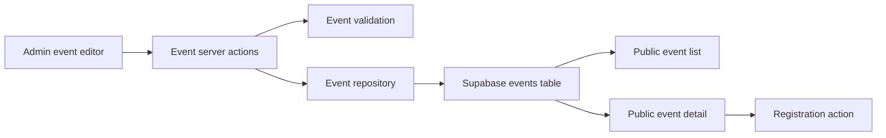

# Supabase Event Editor Design

## Summary

SnowForce activity content must move out of frontend seed data so staff can
create, edit, publish, and operate events from the admin area. This increment
uses Supabase `events` records as the operational source of truth while keeping
the current password-backed admin session for staff access.

The first editor is intentionally focused on events. It does not add Supabase
Storage uploads, Supabase Auth staff migration, rich text editing, bulk import,
version history, or full database editors for recaps and FAQ content.

## Goals

- Read public event list and detail content from Supabase event records.
- Let an authenticated admin create an event draft and edit the full event
  content needed by the existing public pages and registration form.
- Let an authenticated admin publish or unpublish events and open or close
  registration.
- Preserve the current bilingual event model and configurable registration
  fields.
- Make existing seed events importable into Supabase so daily activity updates
  no longer require code edits.

## Non-Goals

- Uploading images to Supabase Storage from the event editor.
- Replacing `/staff-login`, `ADMIN_PASSWORD`, or the local admin cookie with
  Supabase Auth and `staff_roles`.
- Building generalized CMS editing for recaps, FAQ items, media assets, or
  inquiries.
- Adding a rich text editor, preview workflow, event duplication, version
  history, or batch tools.

## Recommended Approach

Use Supabase as the primary event data source. Route all admin mutations through
server actions that check the existing admin session, validate input, write via
the event repository, and revalidate public and admin pages after successful
changes.

Public event reads may use the public Supabase client path permitted by the
published-event RLS policy. Because this increment keeps the existing local
admin password session instead of signing staff into Supabase Auth, admin event
writes use a server-only Supabase secret or service-role key after
`requireAdmin()` succeeds. That privileged key must never be exposed through a
`NEXT_PUBLIC_` variable or used in browser code.

The existing `events` schema already covers the required fields: bilingual
content, location and timing, capacity, registration window and form fields,
cover image string, tags, SEO fields, status, and registration state. The
editor stores the cover image as a URL or path string in this increment.

The code should not keep long-term operational behavior split equally between
Supabase and in-memory seed repositories. When Supabase is unavailable, public
and admin surfaces should make configuration state clear rather than silently
acting like the production dataset is empty. Seed data remains useful as import
input and development reference, not as the normal activity update path.

## Architecture

### Boundaries

- Public event pages query published events through the event repository.
- Admin pages query drafts and published events through admin repository
  methods.
- Admin UI code never writes directly to Supabase from the browser.
- Event validation owns input parsing and publish completeness checks.
- Event mapping code owns conversion between database snake-case columns such
  as `title_en` and domain fields such as `title.en`.
- Registration continues to validate event status, registration state,
  registration window, and capacity on the server.

## Admin Experience

### Routes

- `/admin/events` lists events and provides create, edit, publish/unpublish,
  and registration open/close entry points.
- `/admin/events/new` creates a new draft through the full editor.
- `/admin/events/[slug]/edit` edits an existing event through the full editor.

### Editor Sections

1. Basic information:
   - slug
   - event start and end time
   - location and map URL
   - capacity
   - cover image URL or path
2. English content:
   - title, subtitle, description
   - highlights
   - schedule
   - fee information
   - notices
   - tags
3. Chinese content:
   - the same content fields as English
4. Registration:
   - registration open and close times
   - registration state
   - configurable registration fields
   - field labels, required toggles, and select options
5. SEO:
   - bilingual SEO titles and descriptions

### Publishing

Drafts may be incomplete and save successfully. Publishing performs a stronger
completeness check so a public event cannot ship without the bilingual content
and operational fields required by the current public detail page and
registration flow. The admin UI reports missing fields rather than failing
silently.

## Data Flow

### Public Reads

- Event listing reads `status = published`.
- Event detail reads a published event by `slug`.
- Draft slugs are not publicly accessible through the event detail path.

### Admin Reads and Writes

- Admin event listing reads all events.
- Create action inserts a draft event after parsing form input.
- Update action updates an existing event after parsing form input.
- Publish action verifies publish completeness before changing status.
- Registration-state action changes `open`, `closed`, or `full` state without
  bypassing admin authorization.

### Seed Transition

Current seed event records remain a starting dataset. The implementation should
provide a clear one-time import path or documented insert process for moving
those records into Supabase. After import, staff should update activity content
in the admin editor instead of editing `src/lib/events/seed.ts`.

## Code Shape

- `src/lib/events/repository.ts` exposes event read and write operations.
- `src/lib/events/mappers.ts` maps Supabase event rows and write payloads to the
  domain `Event` shape.
- `src/lib/events/validation.ts` validates editor input and publish readiness.
- `src/lib/events/actions.ts` contains admin-only server actions and page
  revalidation.
- `src/app/admin/events/*` hosts list, create, and edit routes.
- `src/components/admin/*` may host focused event editor form controls where
  sharing or file size warrants extraction.

## Validation and Error Handling

- Missing Supabase configuration is surfaced clearly when event persistence is
  required.
- Save failures keep the form input visible and return actionable feedback.
- Publish failures list incomplete or invalid fields.
- Slugs must be present and stable enough for URLs.
- Capacity must be non-negative.
- Event end time must not precede event start time.
- Registration close time must not precede registration open time.
- Registration field configuration must remain compatible with the current
  registration form types.
- Public readers must not expose drafts.

## Testing

- Mapper tests cover Supabase column conversion and write payload shape.
- Validation tests cover editor input, date ordering, capacity, registration
  field configuration, and publish completeness.
- Repository tests cover public published filtering and admin all-event access
  at the repository boundary.
- Server action tests cover admin authorization and validation result handling
  where current project patterns allow focused tests.
- Final verification runs targeted tests, full tests, lint, and production
  build. A configured Supabase environment should also receive a simple read or
  write-path verification query before claiming database integration works.

## Acceptance Criteria

- Staff can create an event draft from the admin area.
- Staff can edit all event fields currently required by public event pages and
  configurable registration fields.
- Staff can publish an event only after required bilingual and operational
  fields pass validation.
- Published events render from Supabase on public list and detail pages.
- Draft events remain absent from public event pages.
- Staff can open or close registration from the admin area.
- Seed activity updates are no longer the normal workflow after Supabase event
  records are imported.
